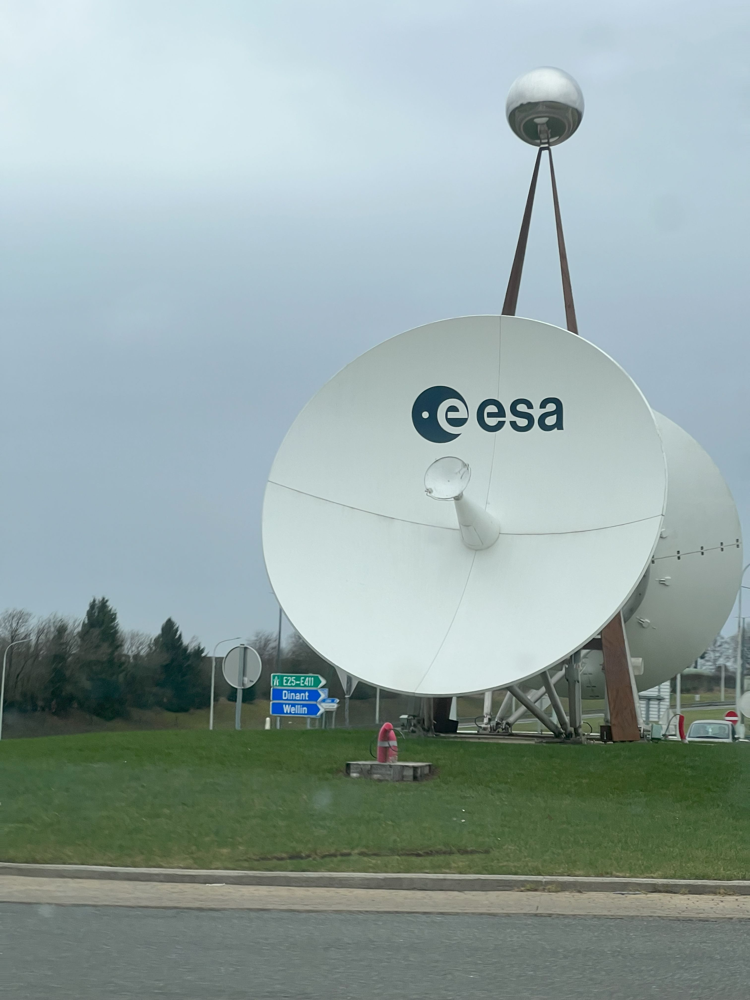

I am also a software-defined radio developer for the [UBC Orbit Satellite Design Team](https://www.ubcorbit.com/). We are developing a CubeSat with Simon Fraser University as part of the [European Space Agency's Fly Your Satellite! programme](https://www.esa.int/Education/CubeSats_-_Fly_Your_Satellite/New_missions_selected_for_the_fourth_edition_of_the_Fly_Your_Satellite!_programme). Our satellite, ALEASAT, will take photos from space to help amateur radio operators (like me) with satellite imagery for disaster relief.

