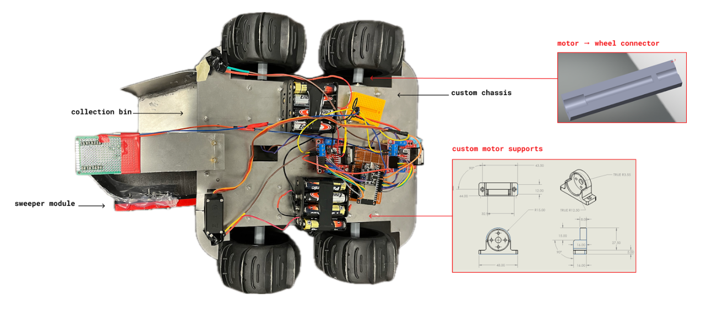
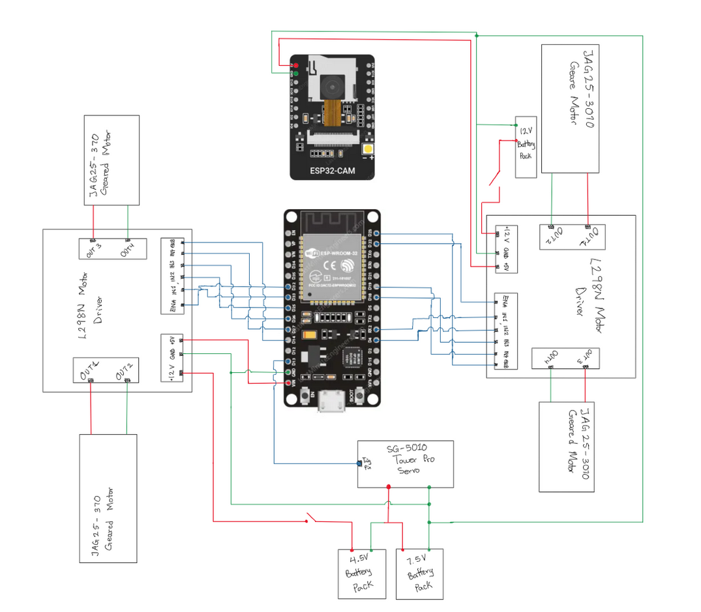
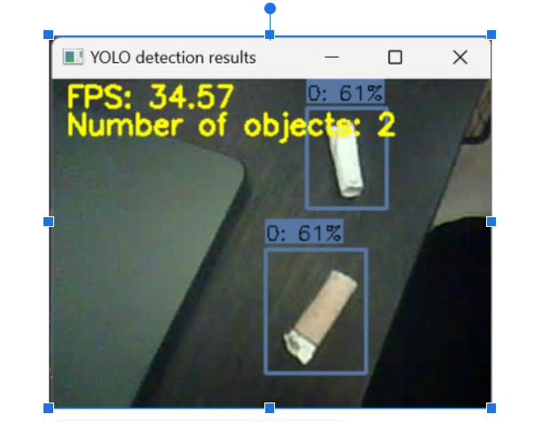
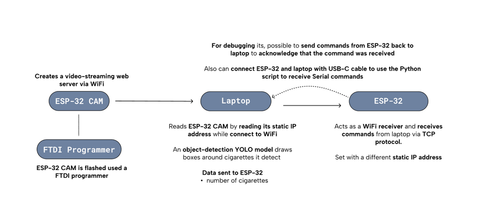

Source code: <https://github.com/va7mii/BeachBot-IGEN230>

## Robot Setup

_Physical design of the robot used for the ESP-32 cam. It's designed to detect and collect street waste._

_Wiring setup of the ESP32, camera, motors, and battery._

_Object detection using the ESP32-Cam's video data, 640 × 480 resolution._

## WiFi Setup

- Static IP on the ESP-32 camera and the ESP-32, so everything can connect to a hotspot without reconfiguring IPs.
- A laptop runs object detection and sends data back to the ESP-32.

## Communication Diagram

## Issues

- The servo motor jitters while it's running and receiving WiFi; this might be a timing issue.
- Watchdog resets, most likely from a timeout when the ESP doesn't receive data for a set time.
