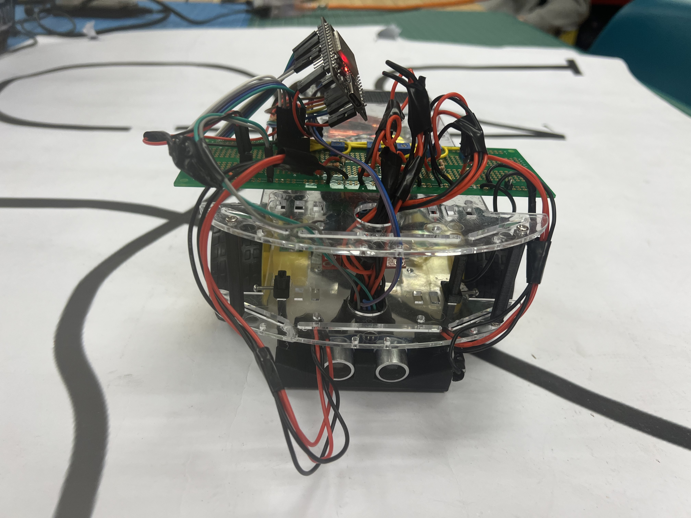
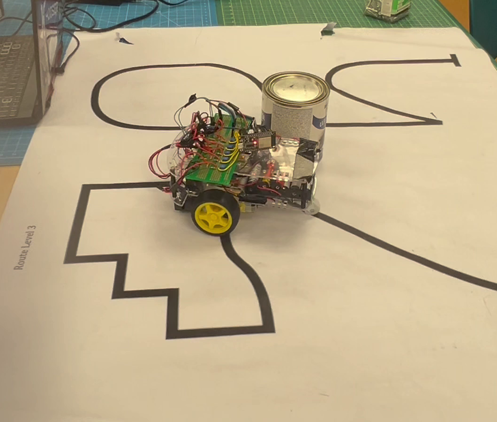
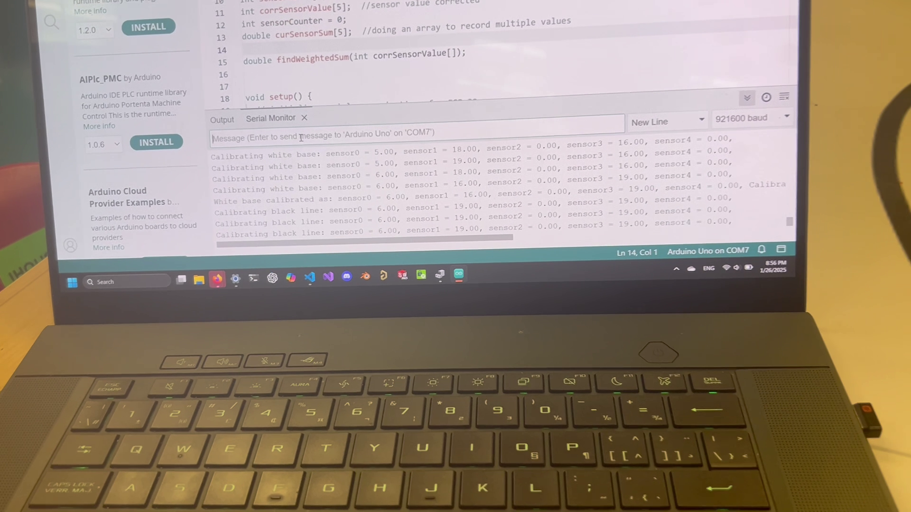

> **TL;DR**: Using Bluetooth and FreeRTOS to read data from the robot and control it wirelessly.

Source code: <https://github.com/va7mii/IGEN230-Line-Robot>

In IGEN 230 (2nd year project course), we had to build a line following robot using an ESP-32. To make things interesting, I decided to use Bluetooth to control the robot and help with calibration.

The code uses FreeRTOS (a real-time operating system) to run multiple tasks at once.

- **Pros:** easier to organize code, precise timing of tasks, a chance to improve my C skills
- **Cons:** big learning curve, risk of resetting the ESP32 due to a memory leak

When connected over Bluetooth, the ESP32 pairs with any device that can do serial input (e.g. a Windows laptop or an Android device).

Bluetooth output: IR sensor data on a serial terminal. The user can also send commands in the format `[character] [number] [some other number]`:

```cpp
s [leftSpeed] [rightSpeed] // used by the joystick to control left and right motors
c // trigger a calibration reading
m // manual control
a // switch back to automatic line following
p/i/d/b [value] // adjust Kp, Ki, Kd (PID parameters) or base speed on the fly
```

An example of commands read from serial by the robot:

```cpp
c         // Reads the sensor values from the white surface
c         // Reads values from the black line
// Robot is moving
b 45      // Change base speed to 45
p 30      // Change the Kp parameter (in PID control) to 30
m         // Change to manual mode [or controller 'A' button]
// [controlling the robot with the controller's two joysticks]
s 10 10   // left motor = 10, right motor = 10, go straight
s 10 -10  // left motor = 10, right motor = -10, right turn
s 0 0     // stop robot
a         // switch back to automatic line follow mode
// [turn off] / [reset button]
```

The ESP32 runs Serial Read, Sensor Task, and Motor Task concurrently.

When calibrating, the ESP32 prints output like:

```text
Calibrating white base: sensor0 = 21.00, sensor1 = 31.00, sensor2 = 0.00, sensor3 = 29.00, sensor4 = 0.00,
```

For the black line, the ESP32 keeps the maximum reading it has received so far, to capture the highest possible sensor value on a black line.

## Using a Nintendo Switch Pro controller

The left and right joysticks (Y-axis) control the speed of the left and right motors in both directions. A Python script (using PyGame) converts joystick input into `s [leftMotor] [rightMotor]` commands. Because of that, the user has to hold the right trigger "R" to drive with the joysticks.

Other keybindings:

- Left trigger "L" sends `c` for calibration
- "A" button sends `m` for manual mode
- "B" button sends `a` for auto mode

## BOM Highlights

| Part                 | Purpose                                   |
| -------------------- | ----------------------------------------- |
| ESP32-WROOM-32D      | MCU + Wi-Fi/BLE                           |
| L298N H-bridge       | Motor driver                              |
| QR1114 IR sensors ×5 | Line detection (IR LED + phototransistor) |

## Photos


_Front view of the robot._


_Robot on the track._


_Calibration info on the serial monitor._
