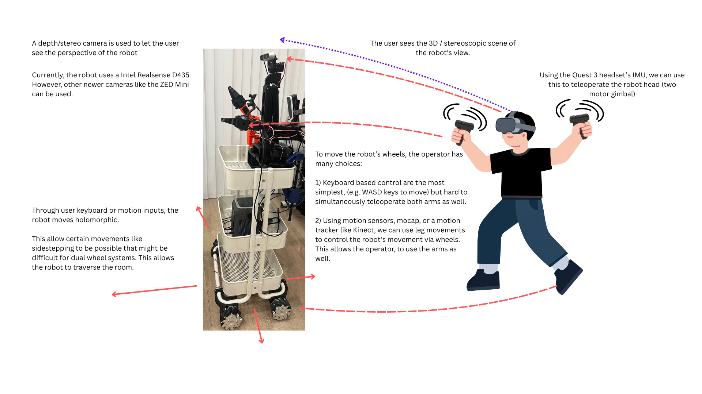
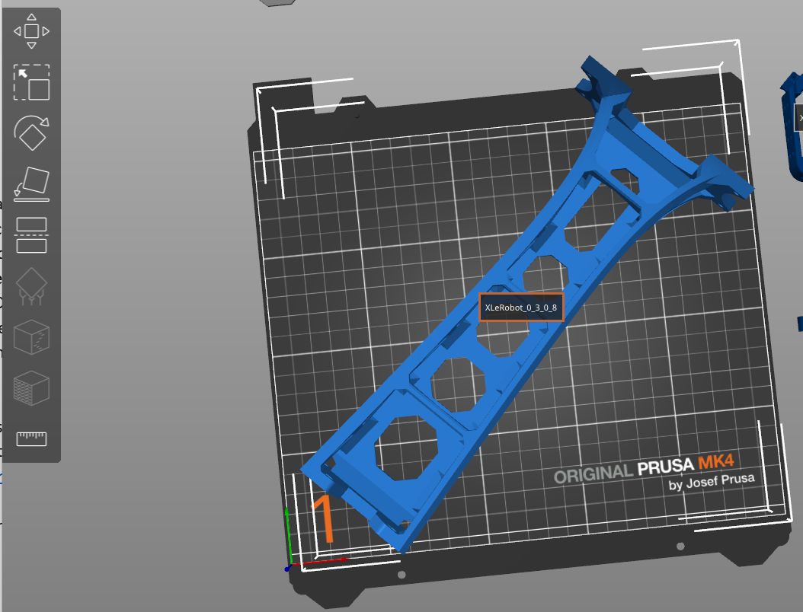
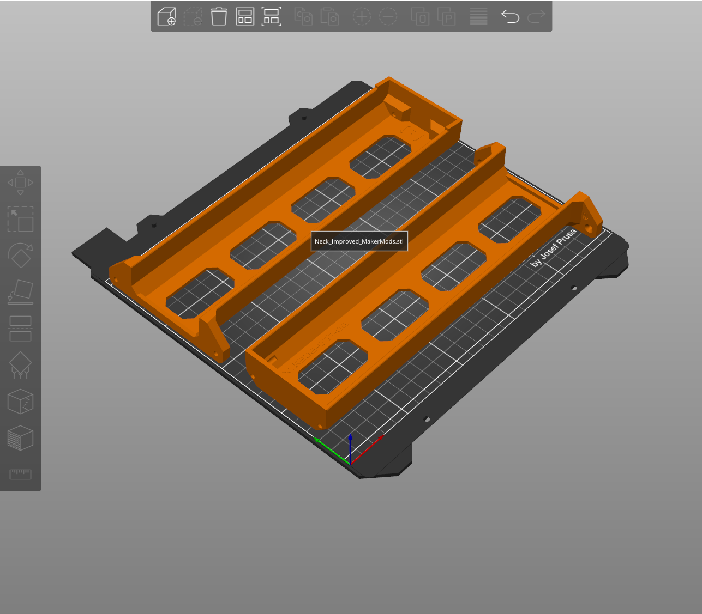

> **TL;DR**: Last summer I built a modified [XLeRobot](https://github.com/Vector-Wangel/XLeRobot) on an IKEA RÅSKOG cart to learn physical AI and explore low-cost human telepresence. It has two arms, mecanum wheels and an Intel RealSense D435 camera, and I'm working toward controlling it with a Meta Quest 3. It's a work in progress, so here is what I've got so far.

_The robot, and the planned flow: operator movements drive the robot, and the robot sends 3D video back to the headset._

## Why Telepresence

Telepresence moves from flat video calls to actually being somewhere through a robot. A patient who can't leave bed could still move around with family, friends far apart could meet in a more natural way, and a person could control a robot precisely for dangerous jobs like pipeline inspections.

Older telepresence robots were mostly a screen on wheels showing the operator's face, which can't pick anything up. Teleoperation is also how robots collect data for imitation and reinforcement learning, so a telepresence robot doubles as a way into training AI policies.

## Why XLeRobot

- **Community:** it has a large community and builds on [LeRobot](https://github.com/huggingface/lerobot), which already has ways to teleoperate arms and wheels.
- **Low cost:** the IKEA RÅSKOG cart is tall enough for the camera and arms to reach everyday human tasks.
- **Mecanum wheels:** a mecanum variant, still being tested, lets the robot move holonomically (sideways as well as forward), which makes "walking" motions possible. Building it also helps verify the new design.

## The Build

Most parts are printed in PETG, with TPU for the grippers, both with gyroid infill for easy printing and even strength. The original XLeRobot neck doesn't fit the Prusa MK4's build volume, so I used [MakerMods'](https://github.com/makermods-robotics/MakerMods-XLeRobot) version, which splits it into pieces that fit and keeps the same height.

_The original XLeRobot neck doesn't fit the MK4's build volume._

_The MakerMods neck fits the MK4 and reaches the same height._

The base motors and head motors need longer wires than the kit comes with, so I made custom cables with Molex 5264 connectors. Finding the right crimper and the 5264 (SPOX) pins was a struggle. The LeRobot Discord pointed me to a crimper (an Engineer PA-09), and Lee's Electronics, a local electronics shop, had the pins. That let me route 22AWG wires to the mecanum wheels and the head.

## How It's Controlled

A PC host sends commands over ZMQ (in Python) to a computer on the robot, which runs LeRobot to drive the ST3215 motor boards and read the cameras. At the time of writing this was a laptop running Ubuntu with Xfce, and moving it to a Raspberry Pi 5 is in progress.

Right now I drive it with the XLeRobot keyboard scripts and am experimenting with the Quest 3's motion sensors and controllers. The 3D video stream works, but the full VR setup (motion control plus seeing through the RealSense) is still in progress.

For 3D vision there are two approaches I'm looking at:

- **Two cameras:** one camera per eye, using the RealSense's two monochrome cameras. The cameras have to be closely synchronized and need wide-angle lenses. Cameras like the ZED Mini or Waveshare IMX219-83 give two colour views but no laser depth.
- **Rendering:** build a depth map and render the scene with Gaussian splatting. That avoids syncing two cameras, though the image may be lower quality than a normal camera.

## Challenges and Debugging

- **Brownouts during homing:** when both arms and the head calibrated at once, one arm would lose control and the ST3215 servos disabled. The likely cause was the 12V USB-C to DC cables, which are limited to 3 A, while the SO-101 arm design recommends at least 5 A. Restarting the power bank brought it back. I changed the script to home each arm separately and much more slowly (about 5 seconds), which avoids too much current and jitter. A better battery, such as a lithium-ion pack that gives more control over power delivery, is something to explore.
- **Wayland vs. X:** many tools still depend on the X display server while newer Linux distributions are moving to Wayland, which broke the libraries for keyboard teleoperation at first. Switching to Xfce on X fixed it.

## Cost

| Item                         | Cost (CAD) |
| ---------------------------- | ---------- |
| Anker SOLIX C300             | $280       |
| ST3215 servos (×18)          | $350       |
| Motor boards (×2)            | $30        |
| USB-C to DC cables, 12V (×2) | $26        |
| Anker USB hub                | $12        |
| Filament (TPU and PETG)      | $78        |
| Ball bearings (×2)           | $30        |
| Mecanum wheels (×4)          | $220       |
| RealSense camera             | $350       |
| **Total**                    | **$1,376** |

That's cheap compared to robots like the Unitree Go2 (about $1,600 USD). The laptop, Raspberry Pi 5 (reused from an old project) and Quest 3 aren't included.

## What's Next

I'm still working on training AI policies with the robot. Other things I want to try:

- More cameras, like the ZED Mini or a simple pair of wide-angle cameras.
- A Kinect or motion capture to drive the mecanum wheels by walking, so both hands stay free for the arms.
- Brain-computer interfaces or EEG readers, so patients who can't move could still fetch an item and feel present with family and friends.
- Legs or tracks for uneven ground like stairs.
