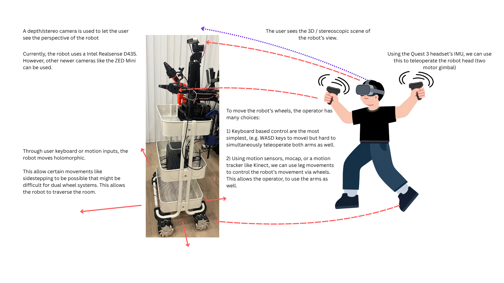
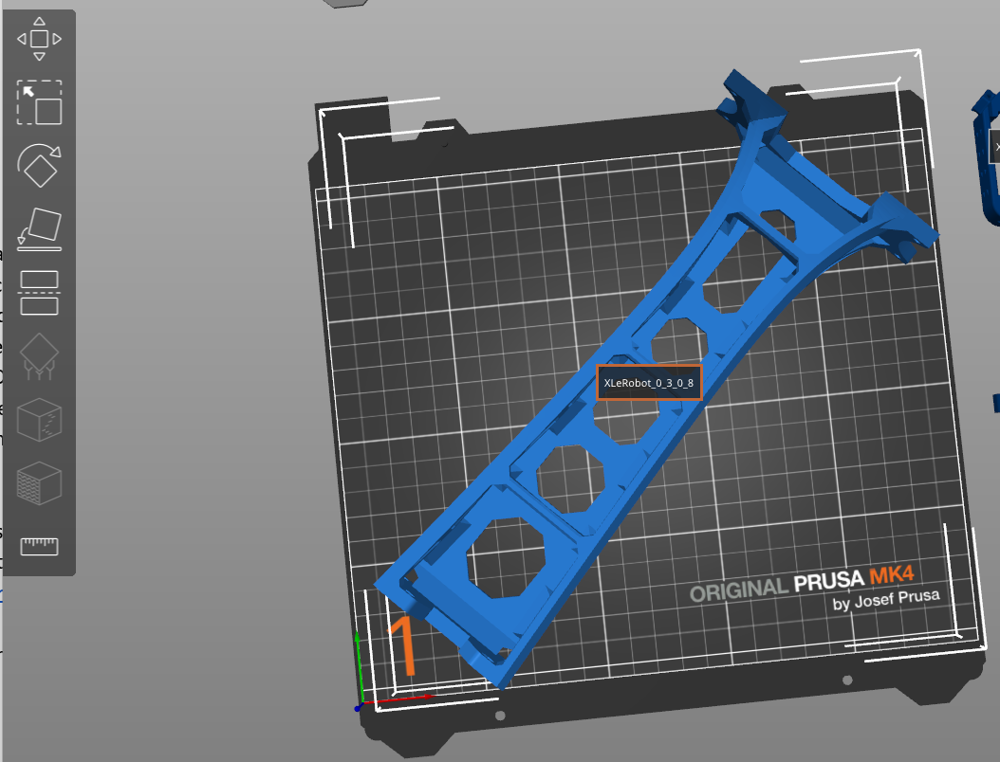
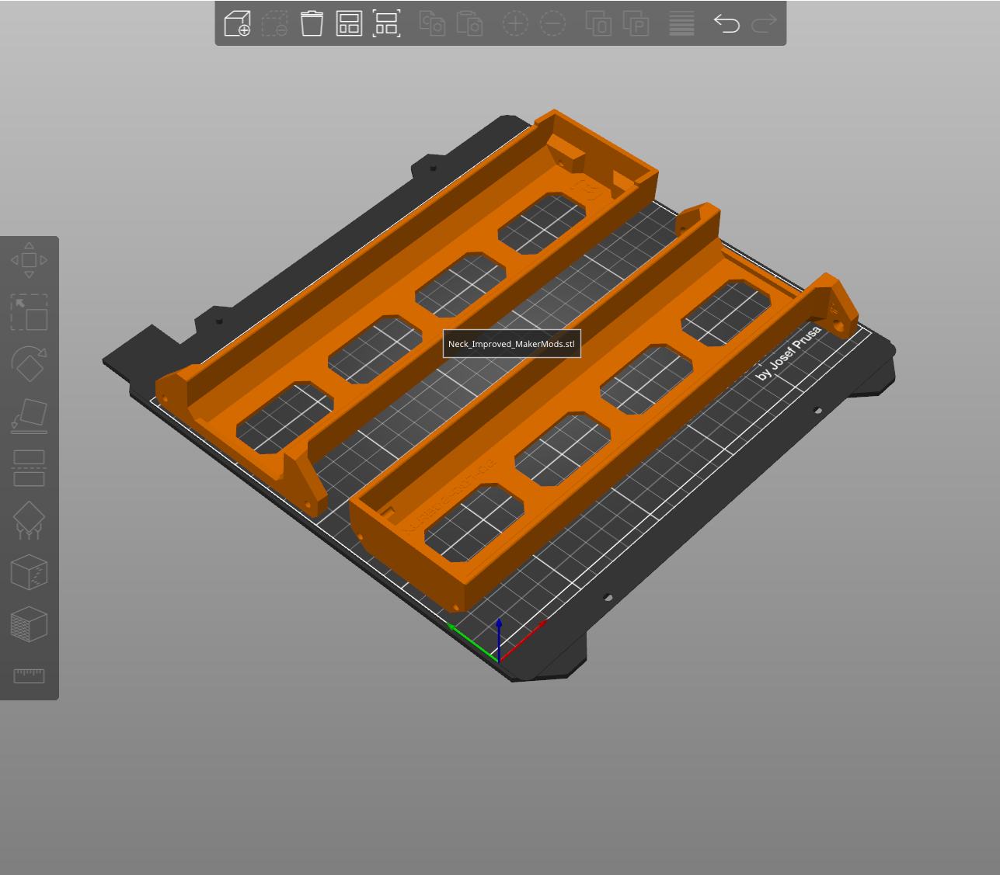

> **TL;DR**: Last summer I built [XLeRobot](https://github.com/Vector-Wangel/XLeRobot), an open-source mobile robot with AI-controlled arms that sits on an IKEA cart, to teach myself physical AI. This is an early journey, so here is what I've got so far.

_XLeRobot on its IKEA cart, and my idea for using it for telepresence with a Quest 3 headset._

## Why XLeRobot

I wanted to learn physical AI hands-on: getting a model to see the world and move a real arm, not just run in simulation. XLeRobot is a low-cost, open-source build that pairs robot arms with a mobile base made from an IKEA cart, which made it a good way in.

<!-- DETAILS: what drew you to it, and what you hoped to learn. -->

## The Build

The robot sits on a three-tier IKEA cart with mecanum wheels, two arms, and a head that holds an Intel RealSense D435 depth camera on a two-motor gimbal.

Most of the structural parts are 3D printed on a Prusa MK4. The original XLeRobot neck barely fits on the MK4's bed, even placed diagonally, so I printed MakerMods' improved neck instead, which splits it into two pieces that fit comfortably.

_The original XLeRobot neck (v0.3.0) only just fits across the MK4's bed._

_The MakerMods neck, split into two halves sized for the MK4._

<!-- DETAILS: how long assembly took, other changes from the reference design. -->

## Bill of Materials

| Part                         | Qty | Notes                                                        |
| ---------------------------- | --- | ------------------------------------------------------------ |
| IKEA RÅSKOG cart             | 1   | Three-tier mobile base frame                                 |
| Mecanum wheels               | 4   | Holonomic drive <!-- link to come -->                        |
| Feetech ST3215 servos (12V)  | 16  | 6 + 6 + 4                                                    |
| Raspberry Pi 5 (8GB)         | 1   | With a 128GB NVMe SSD, reused from an old project            |
| Anker SOLIX C300             | 1   | Portable power station                                       |
| Intel RealSense D435         | 1   | Depth/stereo camera in the head                              |
| Hand cameras                 | 2   | One on each arm                                              |
| 5264 connectors + 22AWG wire | —   | Crimped with an Engineer PA-09, parts from Lee's Electronics |
| 3D-printed parts             | —   | Printed on a Prusa MK4, including the MakerMods neck         |
| Meta Quest 3                 | 1   | Optional, for telepresence                                   |

<!-- DETAILS: rough total cost. -->

## Challenges as Puzzles

Plenty went wrong, and most of it felt more like a puzzle than a setback. Some components weren't getting enough power, so I had to trace where the power was going and figure out how to supply each part properly.

<!-- DETAILS: other puzzles you hit and how you solved them. -->

## AI Control

<!-- DETAILS: how you control it today, data collection and any policy you trained (e.g. with LeRobot), and what it can do so far. -->

<!-- VIDEO/GIF: the arm doing a task. Save as src/assets/projects/xlerobot/demo.gif, then uncomment:

_The arm running a learned task._
-->

## What's Next

This is still the start. One idea I want to try is using XLeRobot for telepresence: controlling it remotely with a Meta Quest 3 so it feels like being there in person. The diagram at the top shows how it could work:

- **Vision:** the depth camera streams a stereoscopic view, so the operator sees what the robot sees in 3D. The robot uses an Intel RealSense D435 today, but a newer camera like the ZED Mini could work too.
- **Head:** the headset's IMU tracks the operator's head, and the robot's two-motor gimbal copies it.
- **Arms:** the Quest controllers drive the two arms.
- **Wheels:** the mecanum wheels let the robot move holonomically, so it can sidestep in ways a two-wheel base can't. Keyboard control (WASD) is the simplest option, but makes it hard to drive the arms at the same time. A motion tracker like a Kinect could map leg movements to the wheels instead, leaving both hands free for the arms.

<!-- DETAILS: other next steps. -->
